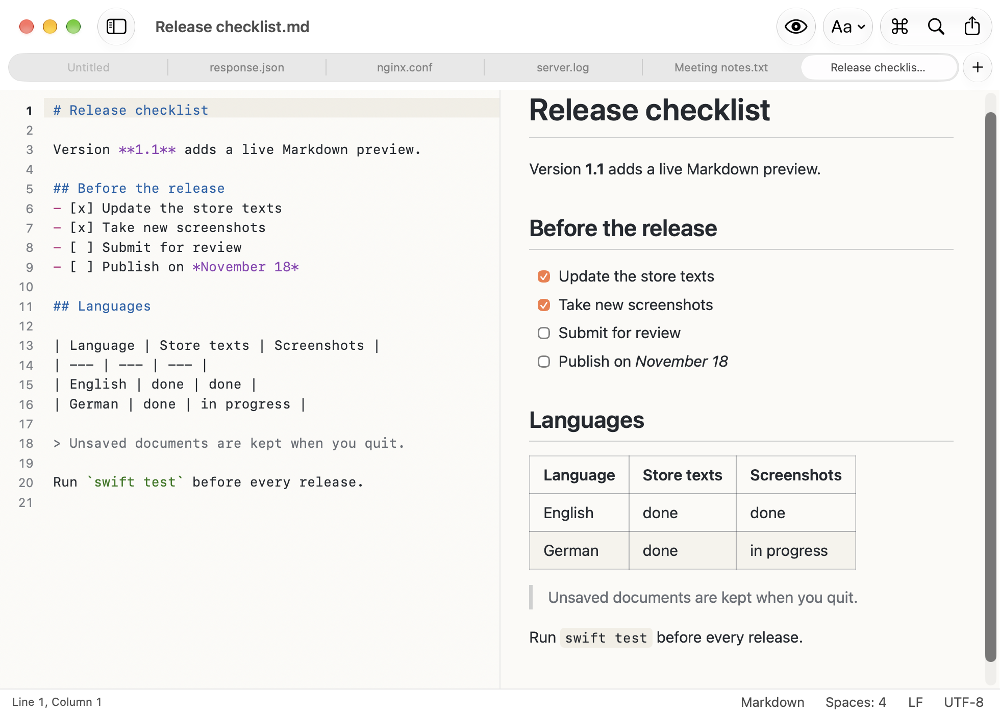

# NoteCraft

**The free Mac text editor that never forgets.** Unsaved tabs survive every quit, encodings and line endings stay intact, and Markdown gets a live preview. It's native and open source, with no subscription and no data collection.



## Why NoteCraft

Many people who move from Windows to the Mac miss Notepad++: one quick place for everything that is text, where nothing is lost when you close it. NoteCraft brings those habits to the Mac as an independent, native app. TextEdit defaults to rich text and smart quotes, and a full IDE is too heavy for a log file. NoteCraft sits in between: it starts instantly, never changes your code and keeps every unsaved tab.

NoteCraft is an independent project and is not affiliated with Notepad++.

## What it doesn't do

- No plug-ins or macros
- No autocompletion, language servers, Git integration or terminal
- No side-by-side editing of two files and no diff
- No iCloud sync and no iPhone or iPad app
- Requires macOS 26 or later

The interface is available in English and German.

## Highlights

- **Nothing gets lost:** untitled and unsaved documents survive quitting and come back at launch; autosave and Versions included.
- **Encodings under control:** detection (BOM, UTF-8, UTF-16 heuristic, declared charsets), *Reopen with Encoding* and *Convert to Encoding*, and a lossy-save check that names the character, line and column.
- **Line endings:** LF, CRLF and CR detection, conversion and an indicator for mixed line endings.
- **Search:** find bar with live match count, regular expressions with inline validation and a cheat sheet, replace with `$1` templates, and Find in Files across a folder with glob patterns.
- **Editing:** syntax highlighting for 32 languages, line numbers, current-line and bracket highlighting, invisible characters, multiple cursors and column selection, select next/all occurrences, auto-indent, auto-closing pairs, comment toggling, line operations and text transformations (case, Base64, URL, HTML, order-preserving JSON).
- **Markdown:** live preview next to the editor with GitHub Flavored Markdown, synchronized scrolling and theme colors; formatting commands, list continuation, task lists, tables, a table of contents, image drag and drop, HTML export, printing and copying as formatted text.
- **Mac-native:** document-based AppKit app with native tabs, Liquid Glass toolbar and sidebar, command palette (⇧⌘A), Open Quickly (⇧⌘O), a Settings window, built-in help and light, dark and high-contrast themes.
- **Private:** no accounts, no tracking, no network access – except for images from the internet in the Markdown preview, and only when you allow it. NoteCraft runs in the App Sandbox and only opens files and folders you choose. See the [privacy policy](PRIVACY.md).

## Requirements

- macOS 26 or later
- Xcode 27 or later, Swift 6 with strict concurrency
- [XcodeGen](https://github.com/yonaskolb/XcodeGen) to regenerate the project from `project.yml`

## Build and run

```bash
git clone https://github.com/marlonlng/NoteCraft.git
cd NoteCraft
xcodegen generate
open NoteCraft.xcodeproj
```

Run the **NoteCraft** scheme with ⌘R. Debug builds are signed ad hoc and need no Apple Developer account.

For release builds, copy `Config/Local.example.xcconfig` to `Config/Local.xcconfig` and set your own `DEVELOPMENT_TEAM` and `NOTECRAFT_BUNDLE_ID_PREFIX`. The file is ignored by Git.

## Tests

```bash
xcodebuild test -scheme NoteCraft -destination 'platform=macOS'
xcodebuild test -scheme NoteCraftUITests -destination 'platform=macOS'
```

The first command runs the unit tests of the app and NoteCraftKit, the second runs the end-to-end UI tests. The UI tests take control of mouse and keyboard while they run.

## Localization

English is the source language; German is a full translation. All interface texts live in `NoteCraft/Support/L10n.swift`, translations in `NoteCraft/Resources/Localizable.xcstrings` and `NoteCraft/Resources/InfoPlist.xcstrings`. New languages are welcome, see [CONTRIBUTING.md](CONTRIBUTING.md).

## Project structure

| Path | Content |
| --- | --- |
| `NoteCraftKit/` | Framework with the domain logic: encodings, line endings, line index, search, file search, text transformations, syntax highlighting, themes, settings, Markdown rendering and editing |
| `NoteCraft/` | AppKit and SwiftUI app: document, editor, Markdown preview, find bar, status bar, sidebar, command palette, settings, help, menu bar |
| `NoteCraftKitTests/`, `NoteCraftTests/` | Unit tests (Swift Testing) |
| `NoteCraftUITests/` | End-to-end UI tests (XCTest) and screenshot capture |
| `Config/` | Shared build settings and the template for local signing settings |
| `Scripts/` | App icon generation, screenshot composition and App Store export options |

## Assets

```bash
swift Scripts/GenerateAppIcon.swift NoteCraft/Resources/Assets.xcassets/AppIcon.appiconset
swift Scripts/ComposeAppStoreScreenshots.swift <screenshot folder> <output folder> <captions.json>
```

The raw screenshots come from the `AppStoreScreenshotTests` UI test. The captions file is a JSON array of objects with `file`, `headline` and `subline`.

## Contributing

Bug reports, questions, translations and pull requests are welcome in the [issues](https://github.com/marlonlng/NoteCraft/issues). Please read [CONTRIBUTING.md](CONTRIBUTING.md) first and report security issues as described in [SECURITY.md](SECURITY.md).

## License

NoteCraft is licensed under the [Apache License 2.0](LICENSE).

The name “NoteCraft” and the NoteCraft app icon are not covered by this license.

NoteCraft uses [Swift Markdown](https://github.com/swiftlang/swift-markdown) (Apache License 2.0) and [cmark-gfm](https://github.com/swiftlang/swift-cmark) (BSD-style licenses). Their license texts are included in the app under “Help › Acknowledgements”.
